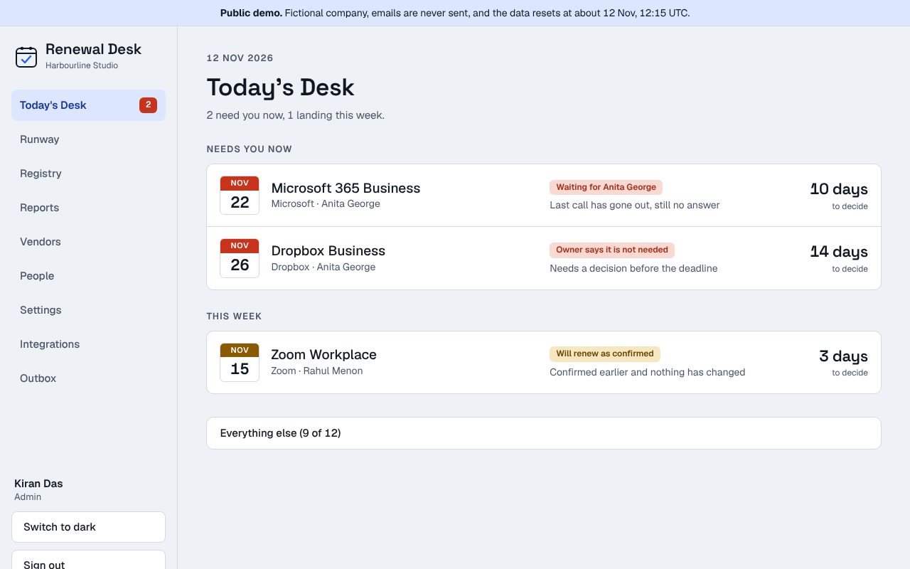
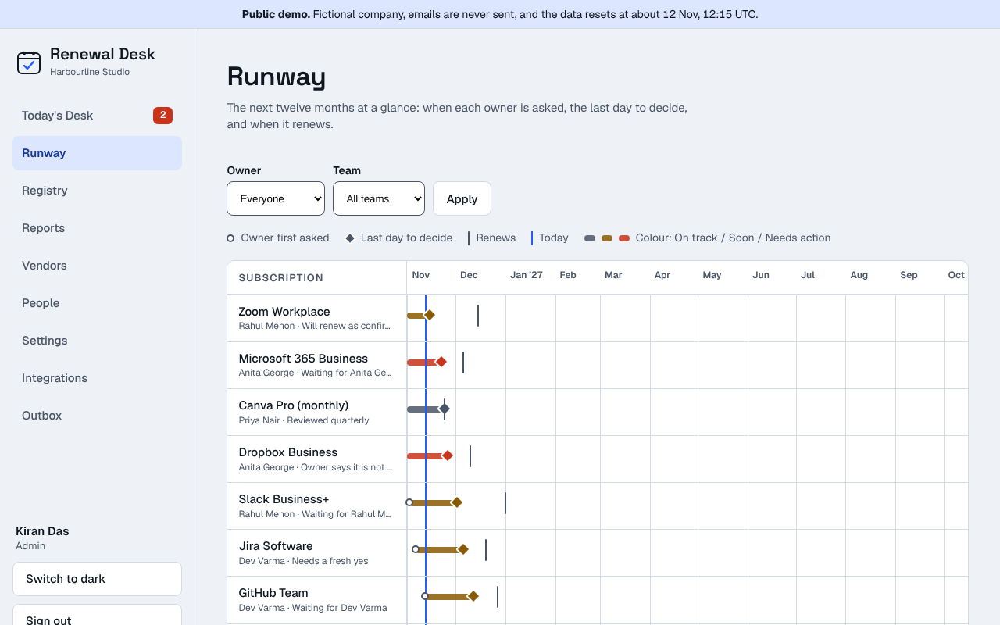
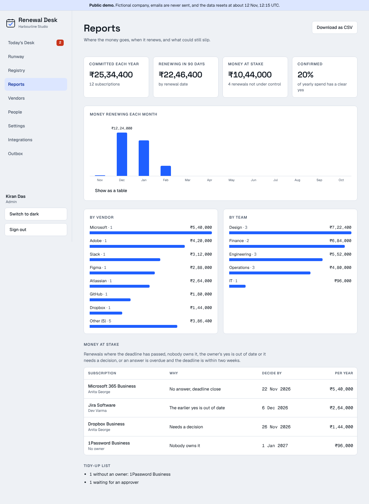

# Renewal Desk

**A subscription renewal workspace built around decisions, ownership and deadlines.**

> A renewal is a decision with a deadline, not just a date on a calendar.

Renewal Desk is an independent product initiative I started to help teams manage the lifecycle of software licences and recurring subscriptions. It aims to make the decision behind each renewal visible: who needs to respond, what the organisation has decided, and how much time remains to act before a cancellation or change deadline.

**Live showcase:** [Open Renewal Desk](https://ajazz-git.github.io/renewal-desk-showcase/)  
**Product status:** Working product · Active development  
**Hosting:** Vercel static deployment  
**Application source:** Private

## Why Renewal Desk?

A spreadsheet can store a renewal date. A calendar can send a reminder. A reliable renewal process also needs clear ownership, a response from the right person, follow-up when nobody responds, and enough time to make a decision.

Renewal Desk is designed around that full decision cycle rather than treating every subscription as a date-only reminder.

## The workflow

1. **Confirm** — ask the subscription owner whether the service is still required.
2. **Follow up** — keep unanswered requests visible and prompt for a response.
3. **Decide** — record whether to renew, cancel, replace or change the subscription.
4. **Protect the deadline** — keep the last day to cancel or change terms visible.

## Product capabilities

- Subscription and vendor registry
- Owner and backup-owner assignment
- Renewal and notice-period tracking
- Owner confirmation and follow-up workflow
- Last-call and overdue visibility
- Approval status and decision history
- A 12-month renewal timeline called **Runway**
- Reports and CSV export
- Calendar feed and integration capabilities

## Screenshots

The interface captures below use fictional **Harbourline Studio** demo data. They were captured on **12 November 2026**. Names, dates and financial figures shown are illustrative and are not customer records.

### Today's Desk

### Runway

### Reports

## Product build

I initiated the product and lead its product direction, problem definition, requirements, workflow design, prioritisation and architecture decisions. Development is AI-assisted, with implementation reviewed and product behaviour validated as it evolves.

**Technology:** Next.js · TypeScript · PostgreSQL · Drizzle ORM · Docker

## Source and availability

This repository contains public-facing product information, selected interface screenshots and the static showcase website only. The Renewal Desk application source code and detailed implementation documentation remain in a separate private repository.

A public interactive application demo is not linked here yet. It will be published only after the demo environment and its external-access safeguards are reviewed.

## Links

- [Product website](https://ajazz-git.github.io/renewal-desk-showcase/)
- [Portfolio](https://ajasmhd.in/)
- [Contact](https://ajasmhd.in/#contact)

---

© 2026 Ajas Muhammed. All rights reserved. See [NOTICE.md](NOTICE.md) for the publication notice.
